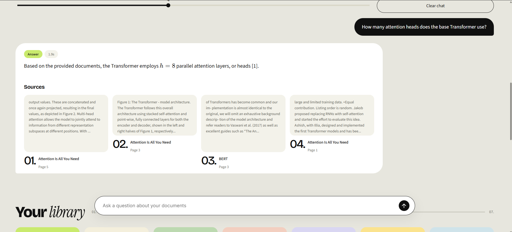

# 📄 RAG Chatbot for Document Q&A

A Retrieval-Augmented Generation chatbot that answers questions over research papers and shows the source passages behind every answer.

**Stack:** LangChain · FAISS · sentence-transformers (all-MiniLM-L6-v2) · Google Gemini · Streamlit



## How it works

1. **Ingest** (`ingest.py`): load PDFs and TXT files from `docs/`, split them into 1000-character chunks with 150 overlap, embed each chunk with all-MiniLM-L6-v2, and store them in a FAISS index.
2. **Retrieve** (`rag.py`): embed the question and fetch the 4 most similar chunks.
3. **Generate** (`rag.py`): send the chunks and the question to Gemini. The prompt tells the model to answer only from the context and to say so when the answer isn't there.
4. **Show sources** (`app.py`): each answer lists the document name, page, and passage it came from.

## Results

Evaluated on 18 questions across 7 research papers: 16 answerable from the papers and 2 out-of-scope.

| Measure | Result |
|---|---|
| Correct answers (manual review) | **13 / 18 (72%)** |
| Keyword match (automatic, not used for scoring) | 14 / 18 |
| Answer time | about 1–4 seconds per question |

The keyword check counted one answer as correct that wasn't (question 17), so I scored every answer by hand.

### Failure analysis

- **Retrieval misses (4 questions):** BERT's pre-training tasks (Q3), the knowledge source of the RAG retriever (Q7), the two networks in a GAN (Q9), and the ILSVRC year for ResNet (Q16). The answers are in the papers, but the right passages weren't in the top 4 results, so the bot refused. In Q9 it retrieved passages from the DCGAN paper instead of the GAN paper.
- **Wrong answer type (1 question):** for "What is the capital of France?" (Q17), the bot answered with a Word2Vec analogy instead of refusing. The keyword check passed it because the answer contained the phrase "provided documents."
- **Imprecise answer (1 question):** for "What are the two RAG model variants?" (Q8), the bot named the correct two models, RAG-Token and RAG-Sequence. It then listed BM25 and Frozen versions as alternative names, but those are ablation settings from Table 6 of the paper, not separate models. I kept this row as correct because the core answer is right.
- **Citation errors:** one claim about GAN training (Q10) cited the DCGAN paper instead of the GAN paper.

## What I learned

- **Retrieval was the bottleneck.** When the right passage wasn't in the top 4, the bot refused instead of guessing. Its errors were missed answers rather than invented facts. Raising the number of retrieved passages or adding a reranker are the next things to test.
- **Keyword matching overstated accuracy.** Automatic matching gave 14/18, but reading the answers gave 13/18. Out-of-scope questions need a stricter test than checking for a phrase.
- **Citations need checking too.** Some answers cited the wrong paper or page, so I verified sources against the PDFs, not just the answer text.
- **Speed depended on the model.** My first run took about 330 seconds per question. Switching to a model that was available for new keys brought answers down to 1–4 seconds.

## Setup

```bash
python -m venv venv
venv\Scripts\activate            # Windows
python -m pip install -r requirements.txt
copy .env.example .env           # then edit .env
```

Edit `.env`:

```
LLM_PROVIDER=gemini
GOOGLE_API_KEY=your_key_here
GEMINI_MODEL=gemini-3.5-flash-lite
```

Get a free key at https://aistudio.google.com/apikey. The model name is the one I tested. Some model names are retired for new accounts, so if you see a 404 error, list the models your key can use and pick a current one.

The Ollama option in `rag.py` is included, but I haven't tested it in this project.

## Run

```bash
# 1. Download the 7 sample papers into ./docs, then build the index
python download_docs.py
python ingest.py

# 2. Launch the chatbot
python -m streamlit run app.py
```

## Evaluation

1. `eval_questions.json` holds 18 questions with expected keywords.
2. Run `python evaluate.py`. It saves `eval_results.csv` and overwrites any earlier file, so copy the file first if you want to keep it.
3. Open `eval_results.csv`, read each `answer`, and set `manual_correct` to 1 or 0. The score is the number of 1s.

The automatic keyword score is only a first pass. Use the manual score for results.

## Possible extensions

- Test retrieval with more passages (for example, 8 instead of 4) and compare the scores
- Add a reranker to improve the passages sent to the model
- Upload PDFs directly from the interface
- Add conversation memory for follow-up questions